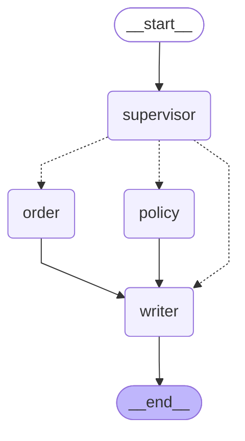
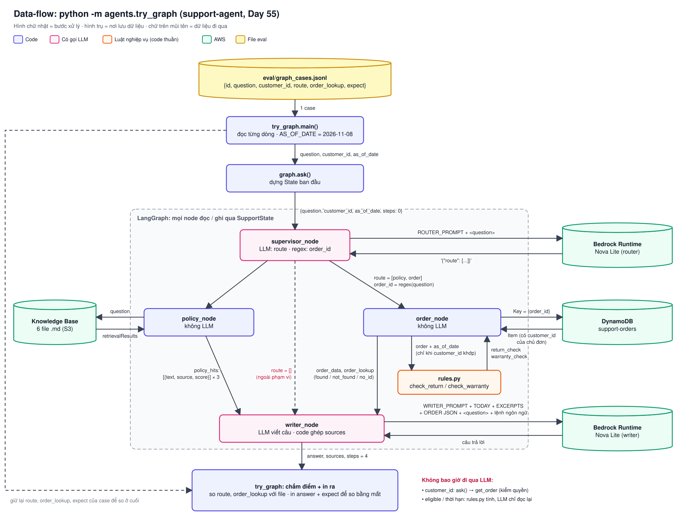
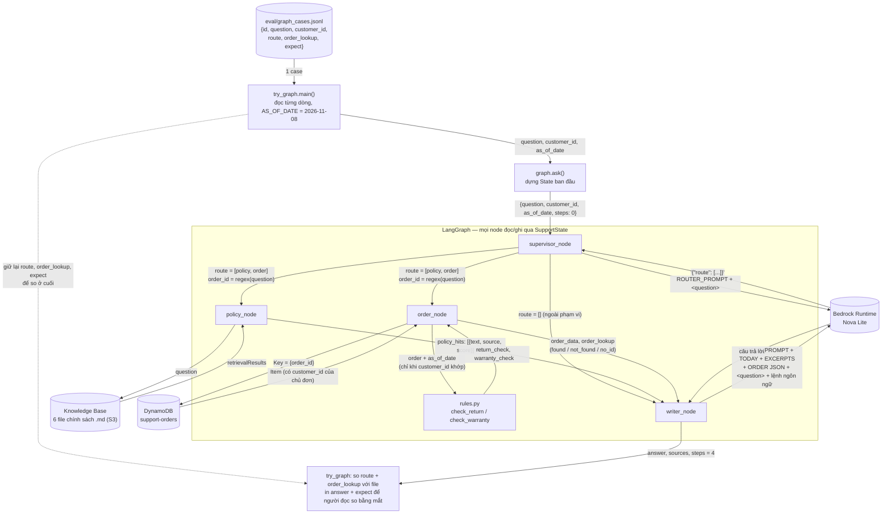

# Sơ đồ graph (Day 55)

Sinh tự động từ code: `python -c "from agents.graph import graph; print(graph.get_graph().draw_mermaid())"`.
Nét đứt = cạnh có điều kiện (supervisor quyết định theo `route`); nét liền = luôn đi.



| Node | Dùng LLM? | Đọc | Ghi |
|---|---|---|---|
| `supervisor` | Có (Nova Lite, temp 0) | `question` | `route`, `order_id` |
| `policy` | Không | `question` | `policy_hits` |
| `order` | Không | `order_id`, `customer_id`, `as_of_date` | `order_data` (+ `return_check`, `warranty_check` từ `agents/rules.py`), `order_lookup` |
| `writer` | Có (Nova Lite, temp 0.2) — trừ câu ngoài phạm vi | tất cả ở trên | `answer`, `sources` |

Mọi node trả `steps: 1`, reducer cộng dồn: cả hai nhánh = 4, một nhánh = 3, ngoài phạm vi = 2.

## Sequence diagram — một câu hỏi chạy qua những hàm nào

Ví dụ câu cần cả hai nhánh: `ask("Đơn #1003 còn đổi trả được không?", "C003")`.
Mỗi `participant` là một hàm/module thật trong repo; mũi tên liền = gọi, nét đứt = trả về.

```mermaid
sequenceDiagram
    autonumber
    actor U as Người dùng (CLI)
    participant G as graph.py<br/>main() / ask()
    participant LG as LangGraph runtime<br/>(graph.invoke)
    participant S as supervisor.py<br/>supervisor_node
    participant L as llm.py<br/>converse_text
    participant BR as Bedrock Runtime<br/>(Nova Lite)
    participant P as nodes.py<br/>policy_node
    participant SP as tools/search_policy.py
    participant KB as Bedrock<br/>Knowledge Base
    participant O as nodes.py<br/>order_node
    participant GO as tools/get_order.py
    participant DB as DynamoDB<br/>support-orders
    participant R as rules.py
    participant W as nodes.py<br/>writer_node

    U->>G: python -m agents.graph "câu hỏi" --customer C003
    G->>G: initial = {question, customer_id,<br/>as_of_date (tham số → AS_OF_DATE → hôm nay), steps: 0}
    G->>LG: graph.invoke(initial, recursion_limit=10)

    Note over LG,S: Superstep 1 — START → supervisor
    LG->>S: supervisor_node(state)
    S->>L: converse_text(ROUTER_MODEL_ID, ROUTER_PROMPT,<br/>"<question>…</question>", max_tokens=100, temperature=0)
    L->>BR: converse() (retry adaptive ×3, timeout 30s)
    BR-->>L: '{"route": ["policy","order"]}' + usage
    L-->>S: (text, usage)
    S->>S: parse_route(text) → ["policy","order"]<br/>(None → fallback cả hai; [] → giữ nguyên)
    S->>S: extract_order_id(question) → "1003" (regex)
    S-->>LG: {route, order_id: "1003", steps: 1}
    LG->>LG: route_after_supervisor(state)<br/>→ route, hoặc ["writer"] nếu route rỗng

    alt route rỗng (ngoài phạm vi / prompt injection)
        LG->>W: writer_node(state)
        W-->>LG: {answer: _OUT_OF_SCOPE[lang], sources: [], steps: 1}<br/>— KHÔNG gọi LLM
    else route có "policy" và/hoặc "order"
        Note over LG,O: Superstep 2 — fan-out: các nhánh trong route chạy SONG SONG
        par route có "policy"
            LG->>P: policy_node(state)
            P->>SP: search_policy(question, top_k=3)
            SP->>KB: retrieve(knowledgeBaseId, query)
            KB-->>SP: retrievalResults (mặc định 5)
            SP-->>P: [{text, source, score}] × 3 (cắt phía client)
            P-->>LG: {policy_hits, steps: 1}
        and route có "order"
            LG->>O: order_node(state)
            alt order_id = None
                O-->>LG: {order_data: None, order_lookup: "no_id", steps: 1}
            else có order_id
                O->>GO: get_order("1003", customer_id="C003")
                GO->>DB: get_item(Key={order_id})
                DB-->>GO: Item | không có
                GO->>GO: Item thiếu HOẶC customer_id khác → None<br/>(Decimal → int)
                alt None
                    GO-->>O: None
                    O-->>LG: {order_data: None, order_lookup: "not_found", steps: 1}
                else đơn của đúng khách
                    GO-->>O: order dict
                    O->>R: check_return(order, as_of_date)
                    R-->>O: {eligible, reason, period_days, days_since_order, last_day}
                    O->>R: check_warranty(order, as_of_date)
                    R-->>O: {eligible, reason, period_months, warranty_until}
                    O-->>LG: {order_data (+2 check), order_lookup: "found", steps: 1}
                end
            end
        end

        Note over LG,W: Superstep 3 — fan-in: writer chạy ĐÚNG 1 LẦN, sau khi mọi nhánh xong
        LG->>W: writer_node(state đã gộp)
        W->>W: lang = question_language(question)<br/>message = build_writer_input(state)<br/>(TODAY, POLICY EXCERPTS, ORDER LOOKUP/ORDER, <question>, lệnh ngôn ngữ ở CUỐI)
        W->>L: converse_text(WRITER_MODEL_ID, WRITER_PROMPT, message, temperature=0.2)
        L->>BR: converse()
        BR-->>L: câu trả lời
        L-->>W: (answer, usage)
        opt answer_language(answer) ≠ lang
            W->>L: converse_text(…, message + "Your previous reply was in the wrong language…")
            L->>BR: converse()
            BR-->>L: câu trả lời
            L-->>W: (answer, usage) — giữ bản này, không lặp nữa
        end
        W->>W: build_sources(state) → tên file chính sách + "orders/1003"
        W-->>LG: {answer, sources, steps: 1}
    end

    LG->>LG: writer → END (reducer: steps = 0+1+1+1+1 = 4)
    LG-->>G: State cuối {route, order_lookup, order_data, answer, sources, steps}
    G-->>U: in ROUTE / ORDER_LOOKUP / STEPS / TRẢ LỜI / NGUỒN
```

Các điểm cần nhớ khi đọc sơ đồ:

| Điểm | Ở đâu trong sơ đồ | Vì sao |
|---|---|---|
| Node không gọi nhau trực tiếp | mọi node chỉ trả dict về `LangGraph runtime` | Runtime gộp dict vào State rồi quyết định node kế tiếp — node chỉ biết State |
| LLM chỉ được gọi ở 2 chỗ | supervisor (phân loại), writer (diễn đạt) | policy/order/rules là code thuần → nhanh, rẻ, ra cùng kết quả mọi lần |
| `customer_id` không đi qua LLM | từ `ask()` thẳng tới `get_order` | Router có bị prompt injection cũng không đổi được khách đang hỏi |
| `par` = fan-out, superstep 3 = fan-in | bước policy ∥ order rồi mới writer | Hai nhánh ghi key khác nhau → không đụng nhau; `steps` có reducer nên cộng được |
| Không phải lúc nào cũng có đủ 2 nhánh | route `["policy"]` → không có `order_lookup`; route `["order"]` → không có `policy_hits` | `build_writer_input` dùng `state.get()` và chỉ thêm phần nào có |

## Data-flow — dữ liệu biến đổi thế nào khi chạy `python -m agents.try_graph`

Sequence diagram ở trên cho biết **hàm nào gọi hàm nào**. Phần này cho biết **dữ liệu nào đi đâu,
bị biến thành gì**. Hình chữ nhật = bước xử lý, hình trụ = nơi lưu dữ liệu, chữ trên mũi tên = dữ liệu.

Bản ảnh khổ lớn (mở riêng để zoom): [data-flow.svg](data-flow.svg)



Bản Mermaid (cùng nội dung):



### State lớn dần qua từng bước — case g01 (khách C003 hỏi đơn của chính mình)

`question = "Đơn #1003 gói Premium của tôi còn đổi trả được không?"`, `customer_id = "C003"`

| Sau bước | Key mới được ghi vào State | Giá trị (rút gọn) | Ai ghi |
|---|---|---|---|
| `ask()` | `question`, `customer_id`, `as_of_date`, `steps` | `"Đơn #1003…"`, `"C003"`, `"2026-11-08"`, `0` | try_graph → ask |
| supervisor | `route`, `order_id`, `steps` | `["policy","order"]`, `"1003"`, `0+1` | LLM (route) + regex (order_id) |
| policy ∥ order | `policy_hits` | 3 đoạn: `01-return-policy.md`, … | KB |
| | `order_data` | `{product: "Webcam HD", order_date: "2026-11-02", status: "delivered", plan: "Premium", customer_id: "C003", …}` | DynamoDB |
| | `order_data.return_check` | `{eligible: true, reason: "within_period", period_days: 14, days_since_order: 6, last_day: "2026-11-16"}` | rules.py (code, không LLM) |
| | `order_lookup`, `steps` | `"found"`, `1+1+1` (2 nhánh cộng qua reducer) | order_node |
| writer | `answer`, `sources`, `steps` | "Đơn hàng 1003 vẫn còn đủ điều kiện đổi trả…", `["01-return-policy.md", …, "orders/1003"]`, `3+1 = 4` | LLM (answer) + code (sources) |

### Cùng luồng nhưng khác dữ liệu — vì sao kết quả rẽ nhánh

| Case | Dữ liệu vào khác ở đâu | Chỗ rẽ nhánh | Dữ liệu ra |
|---|---|---|---|
| g01 | C003 hỏi đơn 1003 (của C003) | `get_order`: `Item.customer_id == "C003"` | `found` → writer có ORDER JSON + 2 check |
| g07 | **C020** hỏi đơn 1036 (của C035) | `get_order`: `"C035" != "C020"` → `None` | `not_found` → writer chỉ nói "không tìm thấy", không có ORDER JSON nào để lộ |
| g08 | C003 hỏi đơn 9999 | DynamoDB không có Item → `None` | `not_found` — **giống hệt g07**, kẻ dò không phân biệt được |
| câu không mã đơn | "đơn của tôi đâu?" | `extract_order_id` → `None`, order_node không gọi DynamoDB | `no_id` → writer hỏi lại mã |
| câu ngoài phạm vi | "kể chuyện cười" | supervisor → `route = []` | đi thẳng writer → câu từ chối cố định, Bedrock không được gọi lần 2, `steps = 2` |

Dữ liệu **không bao giờ đi qua LLM**: `customer_id` (đi thẳng ask → get_order) và các con số
eligible/thời hạn (rules.py tính, LLM chỉ đọc lại). Đó là hai thứ quyết định quyền truy cập và lời
hứa với khách.
